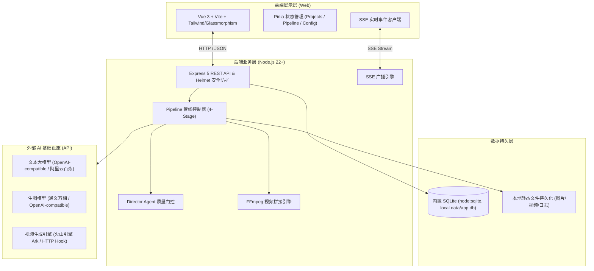

# Comic Drama Engine（漫剧引擎）

[](https://nodejs.org/)
[](LICENSE)
[](https://prettier.io)
[](https://vitest.dev/)

AI 驱动的高品质多阶段漫剧与短片自动化生成管线引擎。用户输入原始小说/故事文本，引擎通过大语言模型与多模态模型流水线（剧本改编 → 资产提取 + 分镜生成 → 参考图生图 → 镜头视频生成），实现全流程自动化、高质量短片制作。

---

## 目录

- [一、项目介绍](#一项目介绍)
- [二、技术架构](#二技术架构)
- [三、环境配置与依赖清单](#三环境配置与依赖清单)
- [四、敏感信息与安全防护](#四敏感信息与安全防护)
- [五、安装运行指南](#五安装运行指南)
- [六、代码规范与工程化](#六代码规范与工程化)
- [七、目录结构](#七目录结构)
- [八、部署指南](#八部署指南)

---

## 一、项目介绍

### 核心功能

1. **智能剧本改编**：LLM 深入理解小说原文，自动改写为专业分场分镜剧本，提供结构化表格编辑、多章节拆分与 AI 智能润色功能。
2. **多模态资产提取与本地上传**：自动析取故事中的核心角色、关键场景与标志性道具；支持从本地直接上传人物/场景设定图片至资产库，分镜生图与视频生成自动作为最高视觉准则锚定，确保人物相貌与服饰一致性。
3. **专业分镜编排**：按场景生成标准分镜表，精准包含景别（特写/近景/全景等）、运镜方式、机位视角、时长与画面描述。
4. **高质量分镜生图**：支持火山引擎 Seedream、通义万相、OpenAI 兼容等多生图模型，每个镜头独立生成参考图，支持多长宽比与模式切换。
5. **AI 视频生成与混剪**：原生支持火山引擎（方舟 Seedance / Ark）、通用 HTTP Hook 接入，涵盖首帧生视频、首尾帧、多图参考、全参考与纯文本驱动模式。
6. **横向视频时间线与配乐音画融合**：可视化的专业剪辑轨道，支持逐镜头预览与微调，内置多款小说专属情境配乐与本地上传，提供基于 FFmpeg 的一键拼接导出功能。
7. **质量门控（Quality Gate）**：各关键阶段配备 Director Agent（导演智能体）进行一致性审核，不合格自动重试。
8. **实时状态推送**：基于 Server-Sent Events (SSE) 协议，毫秒级推送流水线各节点执行进度与错误监控。

---

## 二、技术架构



### 核心技术选型

- **运行环境**：Node.js `>=22.5.0`（充分利用 Node 原生内置 `node:sqlite` 同步数据库引擎，兼具轻量与极高吞吐量）。
- **后端框架**：Express 5 + TypeScript（运行时采用 `tsx`，支持实时 TypeScript 热重载）。
- **前端架构**：Vue 3（组合式 API `<script setup>`）+ Pinia + Vite 5 + 高科技暗色工作台设计。
- **媒体处理**：`ffmpeg-static` 无缝跨平台视频音频合并与重编码。
- **质量监控与测试**：Vitest 单元测试框架 + ESLint 10 + Prettier 代码美化。

---

## 三、环境配置与依赖清单

### 1. 运行依赖要求

- **Node.js**：`>= 22.5.0`（必须，支持原生 `node:sqlite`）。
- **包管理器**：`npm >= 10.9.0`（或 `pnpm` / `yarn`）。
- **操作系统**：Windows 10/11、macOS 或 Linux (Ubuntu 20.04+)。

### 2. 核心依赖清单 (`package.json`)

| 依赖包 | 版本 | 用途 |
|---|---|---|
| `express` | `^5.1.0` | 后端轻量高性能 HTTP 服务框架 |
| `helmet` | `^8.2.0` | HTTP 安全响应头防御常见 Web 攻击 |
| `cors` | `^2.8.5` | 跨域资源共享策略控制 |
| `express-rate-limit` | `^8.5.2` | 接口访问速率限制，防止暴力调用 |
| `zod` | `^3.24.2` | 强类型数据校验库 |
| `jimp` | `^1.6.1` | 纯 JavaScript 图像编解码与多图智能裁切展布拼接 |
| `ffmpeg-static` | `^5.3.0` | 跨平台 FFmpeg 二进制工具包 |
| `@alicloud/bailian20231229` | `^2.14.5` | 阿里云百炼大模型官方 SDK |
| `vue` | `^3.5.13` | 前端渐进式框架 |
| `pinia` | `^3.0.4` | 现代化轻量级状态管理 |
| `vite` | `^5.4.21` | 下一代前端构建与开发工具 |
| `tsx` | `^4.19.3` | 原生快速执行 TypeScript 脚本与服务 |
| `vitest` | `^4.1.7` | 现代化极速单元测试框架 |

### 3. 环境变量模板 (`.env.example`)

项目提供完整规范的环境变量模板。复制并重命名为 `.env` 即可：

```bash
cp .env.example .env
```

环境变量详细说明如下：

```ini
# ──────────────────────────────────────────────
# Comic Drama Engine 环境变量配置
# ──────────────────────────────────────────────

# === 必填安全令牌（生产环境） ===
# 生产环境下必须设置，若为空服务将拦截外部请求并报错
API_TOKEN=your-strong-random-token

# === 服务端口与跨域配置 ===
MY_APP_PORT=3710
# 允许跨域的前端来源（多个以逗号分隔）
MY_APP_CORS_ORIGIN=http://localhost:5177,http://127.0.0.1:5177

# === 公网访问地址（部分视频云异步 Webhook 回调需配置） ===
# MY_APP_PUBLIC_URL=https://your-domain.com

# === 数据传输限制 ===
MY_APP_BODY_LIMIT=20mb
MY_APP_LONG_TEXT_MAX=5000000
MY_APP_SOURCE_TEXT_MAX=12000000

# === 结构化日志配置 ===
MY_APP_LOG_LEVEL=info
# MY_APP_LOG_FORMAT=json
# MY_APP_LOG_TO_FILE=1
MY_APP_LOG_HTTP_SILENT_PREFIXES=/api/files
MY_APP_SERVICE_NAME=comic-drama-engine

# === SSE 长连接保活 ===
# MY_APP_SSE_HEARTBEAT_MS=30000
# MY_APP_SSE_STALE_MS=120000
# MY_APP_SSE_STALE_CHECK_MS=60000

# === 运行环境模式 ===
NODE_ENV=development
```

---

## 四、敏感信息与安全防护

> [!IMPORTANT]
> **关于 API 密钥与数据库安全防泄漏的重要说明**：
> 1. **严禁硬编码敏感密钥**：所有第三方 AI 服务商的 API Key（如百炼 API Key、火山方舟 Token 等）均不在源代码中硬编码。
> 2. **安全的密钥存储机制**：用户可在前端界面的【设置】模块中配置 API Key，该配置安全留存于本地 SQLite 数据库中。
> 3. **数据库与私密文件已全部忽略**：
>    - `.gitignore` 已全面排除 `data/`、`*.db`、`*.db-shm`、`*.db-wal`、`*.sqlite` 以及 `.env` 等文件。
>    - 提交代码到公开仓库时绝不会携带任何本地数据库或敏感环境变量。
> 4. **内置网络防御机制**：
>    - **SSRF 防御**：针对外链下载与 Webhook 引入 DNS 解析检测，禁止访问 `127.0.0.1`、`10.0.0.0/8`、`192.168.0.0/16` 等内网保留网段。
>    - **API 限流与授权校验**：集成 Bearer Token 机制与 Rate Limiter，保障服务安全性。

---

## 五、安装运行指南

### 1. 克隆项目

```bash
git clone git@github.com:zhan-123625/Comic-Drama-Engine.git
cd Comic-Drama-Engine
```

### 2. 安装依赖

```bash
npm install
```

### 3. 环境初始化

```bash
# 复制环境变量模板
cp .env.example .env
```

### 4. 启动开发服务

```bash
# 同时启动后端 API (端口 3710) 与前端开发服务器 (端口 5177)
npm run dev
```

启动完成后，打开浏览器访问：
- **前端工作台**：[http://localhost:5177/mj/](http://localhost:5177/mj/)
- **后端健康检查**：[http://127.0.0.1:3710/api/health](http://127.0.0.1:3710/api/health)

### 5. 快速使用步骤

1. 点击左侧大按钮 **【设置】**，填入您的文本模型（如通义千问/DeepSeek）、生图模型（如通义万相）与视频生成接口配置。
2. 点击 **【新建项目】**，输入项目名称与小说初始文本。
3. 进入 **【剧本】** 页面，点击一键生成分场剧本，可按需拆分章节与微调。
4. 在 **【资产】** 与 **【分镜】** 模块生成角色立绘、场景底图与分镜提示词。
5. 在 **【视频】** 页面挑选镜头一键发起视频渲染，完成后进入 **【时间线】** 预览或直接导出整段短片。

---

## 六、代码规范与工程化

本项目严格遵循现代 TypeScript / Vue 生态主流开发规范：

- **语法与类型检测**：
  ```bash
  npm run lint         # 执行 ESLint 10 静态语法规范检查 (0 errors, 0 warnings)
  npm run lint:fix     # 自动修复常见代码风格与格式问题
  npm run typecheck    # 校验前端与后端 TypeScript 类型
  ```
- **格式化规范**：
  ```bash
  npm run format       # Prettier 统一全项目缩进、引号与分号格式
  ```
- **单元测试**：
  ```bash
  npm test             # 运行 Vitest 自动化单元测试集 (涵盖鉴权、SSRF 防御、文本正则等 76 项测试)
  ```

---

## 七、目录结构

```
Comic-Drama-Engine/
├── server/                        # 后端核心源码
│   ├── agents/                    # LLM 智能体体系（剧本、分镜、资产、导演审核等）
│   ├── application/               # 应用服务层与领域逻辑
│   ├── http/                      # Express 路由控制器、中间件、鉴权与参数校验
│   ├── providers/                 # 模型适配器（OpenAI-compatible / 阿里云百炼 / 火山方舟）
│   ├── utils/                     # 通用工具函数（SSRF 防御、重试、睡眠、安全序列化）
│   ├── config.ts                  # 全局模型配置与持久化
│   ├── db.ts                      # node:sqlite 数据库初始化与事务管理
│   ├── logger.ts                  # 结构化日志系统
│   ├── pipeline.ts                # 四阶段核心流水线调度器
│   ├── sse.ts                     # SSE 实时进度推送
│   └── index.ts                   # 后端主入口
├── web/                           # 前端源码
│   ├── src/
│   │   ├── assets/                # 样式与静态资源
│   │   ├── components/            # 侧边栏大按钮、视频播放器、Toast 等通用组件
│   │   ├── composables/           # Vue 组合式函数封装
│   │   ├── stores/                # Pinia 状态中心 (pipeline / projects / config / ui)
│   │   ├── views/                 # 核心页面视图 (剧本/资产/分镜/视频/时间线/设置)
│   │   └── App.vue                # 根组件
│   ├── index.html                 # 前端 HTML 模板
│   └── vite.config.ts             # Vite 构建配置
├── .env.example                   # 环境变量模板
├── .gitignore                     # Git 忽略规则（严格排除 data、.env、node_modules）
├── Dockerfile                     # 多阶段轻量化生产 Docker 镜像配置
├── ecosystem.config.cjs           # PM2 生产运维配置文件
├── eslint.config.js               # ESLint 规范配置
├── package.json                   # 项目依赖与执行脚本清单
└── README.md                      # 项目说明文档
```

---

## 八、部署指南

### 方式一：PM2 本地生产部署

```bash
# 1. 构建前端生产资源
npm run build

# 2. 通过 PM2 启动服务
npm run deploy:start

# 3. 监控与日志
npm run deploy:logs
npm run deploy:stop
```

### 方式二：Docker 容器化部署

```bash
# 构建镜像
docker build -t comic-drama-engine:latest .

# 启动容器（映射 3710 端口，挂载本地数据目录）
docker run -d \
  --name comic-drama-engine \
  -p 3710:3710 \
  -v $(pwd)/data:/app/data \
  -e API_TOKEN="your-production-token" \
  comic-drama-engine:latest
```

---

## 许可证

本项目基于 [MIT](LICENSE) 开源许可证发布。
